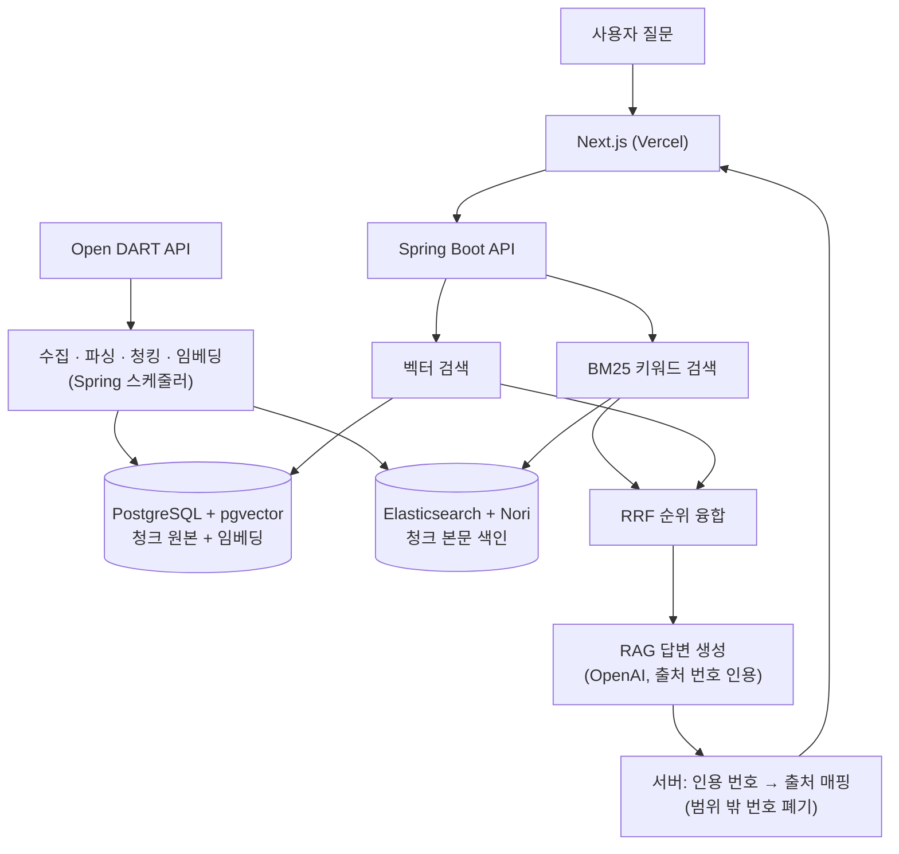

# InsightStock

**하이브리드 검색과 RAG를 활용한 근거 출처 명시형 DART 공시 분석 서비스**
*Evidence-Cited Q&A Service for DART Disclosures Using Hybrid Search and RAG*

DART(전자공시시스템) 공시를 **하이브리드 검색(BM25 + 벡터 + RRF)** 으로 찾고, **RAG로 근거
출처가 명시된 답변**을 생성하는 서비스.

- **Live Demo**: https://frontend-steel-omega-0zye89ut4w.vercel.app
- 백엔드(`https://insightstock.site`)는 비용 관리를 위해 평소에는 인스턴스를 꺼두므로, 데모
  화면은 열리더라도 검색/답변 요청은 응답하지 않을 수 있다. 서버가 꺼져 있을 때는 아래
  [성과 요약](#성과-요약)과 [관련 문서](#관련-문서)로 동작과 측정 결과를 확인할 수 있다.
- **색인 데이터**: 공시 약 3,700건 · 청크 약 17만 건. 수집은 2026년 7월까지 진행했고 이후
  수집 스케줄러는 비용 때문에 중지한 상태라, 최근 공시는 검색되지 않을 수 있다.

## 왜 만들었나

DART 공시는 양이 많고 형식이 제각각이다. 같은 "공시"라도 1,500자짜리 정형 서식(임원
소유상황보고서)부터 12만 자가 넘는 투자설명서까지 섞여 있고, 원하는 내용을 찾으려면 어떤
회사의 어떤 보고서에 있는지 먼저 알아야 한다.

그래서 **자연어로 물으면 관련 공시를 찾아주고, 요약된 답까지 받을 수 있게** 만들었다. 금융
도메인에서는 그럴듯한 오답이 가장 위험하므로, LLM이 지어내지 못하도록 **공시 원문이라는
사실(Fact)에만 근거해 답하고 출처를 항상 함께 보여주는 것**을 핵심 목표로 잡았다.

## 성과 요약

각 수치의 측정 조건과 한계는 링크한 문서에 남겼다.

| 주제 | 결과 | 측정 조건 |
|---|---|---|
| RAG 답변 품질 | 답 없는 질문 8/8 거절, 답변 속 지어낸 수치 0개(2회 측정), 답변 가능 18문항 중 13건 성공(72.2%). 실패 5건은 모두 검색 단계 | 자체 평가 26문항, 문자열 규칙 채점(LLM 심사위원 없음). 정답 판정은 1회 실행, 모든 질의에 회사명 포함 |
| 검색 전략 | 정형 서식은 BM25가 우세, 서술형에서만 벡터가 기여. 하이브리드는 BM25 단독을 넘지 못함 | 자체 평가 세트 18질의([아래 표](#1-하이브리드가-항상-낫다는-가정을-실측으로-검증했다)) |
| 인덱스 | HNSW 유지(738ms → 12ms, Seq Scan 대비 59배), pg_trgm은 적용되지 않고 강제해도 7배 느려 제거 | EXPLAIN ANALYZE, 청크 약 17만 건 |
| 부하 테스트 | 30 VU 성공률 79.7% → 100%, 20→100 VU 15.96% → 94.8%. 병목은 커넥션풀(10)·스레드풀(4) 설정값 | k6, 로컬 단일 머신. 80 VU 이상에서는 풀 고갈이 남아 있음 |
| 배포 충돌 | Blue-Green 전환 중 DB 연결 100개 → 21개 | 로컬 재현, EC2에서 재검증. 전환 검증은 유휴 상태 기준 |
| 비용 | 임베딩 1.1억 토큰을 호출 전에 추정해 실제 사용량($2.23)과 일치, OpenAI 429 에러 3,235건 → 0건 | 로컬 토크나이저 추정, 분당 토큰 한도에서 요청 간격 역산 |

## 핵심 기능

- **DART 공시 수집** — 스케줄러가 Open DART의 공시 목록과 원문(ZIP 안의 XML)을 수집·파싱하고,
  청킹 → 임베딩 → 색인 배치가 이어서 처리한다. 공시마다 `document_status`로 진행 단계를
  기록해, 중간에 실패해도 그 지점부터 다시 처리할 수 있다. 운영 서버에서는 비용 때문에 현재
  수집을 꺼 둔 상태다.
- **하이브리드 검색** — Elasticsearch BM25(Nori 한글 형태소 분석)와 PostgreSQL/pgvector 벡터
  검색(HNSW)을 병렬로 실행하고, 두 순위를 RRF(Reciprocal Rank Fusion)로 합친다.
- **RAG 답변 생성** — 검색된 청크만 근거로 답변을 만든다. 모델은 컨텍스트의 `[1]`, `[2]`
  번호로만 인용하고, 출처는 LLM이 쓴 텍스트가 아니라 **서버가 인용 번호를 실제 청크에
  결정적으로 매핑**해 만든다. 근거가 없으면 정해진 문구로 거절한다.
- **Watchlist / 알림** — 로그인(JWT)한 사용자가 관심 회사를 등록하면, 그 회사의 새 공시가
  수집될 때 알림을 받는다(수집·알림 감지 배치가 켜져 있을 때).

## 아키텍처



- 청크는 Elasticsearch와 pgvector **양쪽에** 저장한다. RRF로 순위를 합치려면 두 검색의 단위가
  같아야 하기 때문이다(근거는 [docs/erd.md](./docs/erd.md)).
- 스키마는 Flyway가 관리하고, JPA는 `ddl-auto: validate`로 검증만 한다.
- 배포: 백엔드는 AWS EC2 한 대(Docker Compose로 Postgres/Elasticsearch, Nginx 리버스 프록시 +
  Let's Encrypt TLS, 애플리케이션은 Blue-Green 방식으로 전환), 프론트엔드는 Vercel.
  절차는 [docs/deploy.md](./docs/deploy.md)에 있다.

## 기술 스택

| 영역 | 선택 |
|---|---|
| 언어 / 런타임 | Java 17 |
| 백엔드 | Spring Boot 3.5.16 (Web, Data JPA, Data Elasticsearch, Security, Validation, Actuator) |
| 빌드 | Gradle 8.11.1 (wrapper) |
| DB | PostgreSQL 16 + pgvector (`pgvector/pgvector:pg16`), 벡터 인덱스 HNSW |
| 검색엔진 | Elasticsearch 8.15.3 + Nori(`analysis-nori`) |
| 마이그레이션 | Flyway |
| 임베딩 / LLM | OpenAI `text-embedding-3-small`(1536차원) / `gpt-4o-mini` |
| 인증 | Spring Security + 자체 발급 JWT (jjwt 0.12.6) |
| 스케줄러 중복 방지 | ShedLock 7.7.0 (Postgres를 락 저장소로 사용) |
| 프론트엔드 | Next.js 16.2.11 (App Router), React 19.2.4, TypeScript 5, Tailwind CSS 4 |
| 인프라 | Docker Compose, AWS EC2, Nginx, Vercel |
| CI | GitHub Actions (`main` push / PR마다 `./gradlew test`) |
| 부하테스트 | k6 |

## 설계 관련 주요 의사결정

### 1. "하이브리드가 항상 낫다"는 가정을 실측으로 검증했다

BM25 / 벡터 / 하이브리드를 같은 질의 세트로 비교 측정했다
([docs/search-quality-eval.md](./docs/search-quality-eval.md)).

| 문서 유형 | BM25 (Recall@20 / MRR) | 벡터 | 하이브리드 |
|---|---|---|---|
| 정형 서식 (라벨+숫자 위주, 질의 12개) | 0.917 / 0.769 | 0.083 / 0.025 | 0.917 / 0.533 |
| 서술형 (질의 6개) | 1.000 / 0.667 | 0.500 / 0.504 | 1.000 / 0.592 |

- **정형 서식 공시에서는 BM25가 압도적**이고 벡터는 거의 기여하지 못했다. 하이브리드는
  Recall은 같지만 MRR이 BM25 단독보다 낮았다.
- **서술형 문서에서는 벡터의 기여가 크게 늘었다**(MRR 0.025 → 0.504). 이 평가 세트에서는
  하이브리드 검색의 가치를 가르는 변수가 "어휘가 일치하는가"보다 **"문서가 정형 서식인가
  서술형인가"** 에 가까웠다.
- **한계**: 모든 질의가 회사명을 포함해 키워드 검색에 유리한 세트이고 표본이 18개로 작다.
  그래서 "벡터가 쓸모없다"고 단정하지 않고 하이브리드를 유지했다.
- 그렇다면 문서 유형별로 검색 전략을 분기해야 할까? **지금은 구현하지 않기로 했다.** 표본이
  작아 과적합 위험이 있고, 질의 시점에 답이 어떤 유형의 문서에 있을지 미리 알 방법이
  없기 때문이다. 다시 검토할 조건까지 문서에 남겼다.

### 2. 환각 제어 — LLM에게 맡기지 않고 서버가 통제한다

- **검색 결과가 0건이면 LLM을 호출하지 않는다.** 근거가 없으면 정해진 문구("제공된 공시
  자료에서는 이 질문에 답할 수 있는 내용을 찾지 못했습니다.")로 바로 응답한다. 다만 벡터
  검색은 무관한 질문에도 청크를 돌려주므로, 대부분의 거절은 LLM 단계에서 프롬프트 규칙
  (컨텍스트에 근거가 없으면 같은 고정 문구로 거절)으로 이뤄진다.
- **출처는 서버가 결정적으로 매핑한다.** 프롬프트의 컨텍스트에 `[1]`, `[2]`… 번호를 붙여
  보내고, 답변에서 실제로 인용된 번호만 뽑아 검색 결과의 해당 청크(회사명, 보고서명, DART
  원문 링크)로 연결한다. 범위를 벗어난 번호는 버리고, 서버가 `citedNumbers`를 내려줘 프론트는
  그 번호의 출처만 배지로 표시한다. LLM이 URL이나 접수번호를 직접 쓰지 못하게 해서
  "그럴듯하지만 존재하지 않는 출처 링크"가 나올 수 없다.
- 시스템 프롬프트는 컨텍스트 밖의 지식 사용과 서로 다른 공시 내용의 결합을 금지하고,
  `temperature`는 0으로 고정했다.
- 이 구조가 실제로 동작하는지 26문항으로 평가했다([성과 요약](#성과-요약) 참고). 답이
  컨텍스트에 있던 13건은 모두 정답 공시를 인용했고, 실패 5건은 전부 검색 단계에서 발생했다.
  병목은 생성이 아니라 검색이라는 뜻이며, 검색 순위 개선은 아직 하지 못했다.

DART 데이터 자체의 함정(원문이 없는 공시, 표준을 지키지 않는 XML, 문서 크기 편차 등)과 그에
따른 청킹 전략은 [docs/dart-findings.md](./docs/dart-findings.md)에 정리했다.

## 알려진 한계와 다음 과제

- 평가는 26문항(답변)·18질의(검색) 규모이고 모든 질의가 회사명을 포함한다. 일반화할 수 있는
  수치가 아니라 이 구조의 동작 여부를 확인한 결과다.
- 부하 테스트는 로컬 단일 머신 기준이다. 80 VU 이상에서는 커넥션풀 고갈이 남아 있다.
- 서버는 EC2 한 대(단일 인스턴스)다. Blue-Green 전환의 DB 연결 검증은 유휴 상태 기준이라,
  두 인스턴스가 모두 부하를 받으면 연결이 최대 100개까지 갈 수 있다.
- 애플리케이션이 DB 관리자 권한 계정으로 접속하는 구성은 아직 분리하지 않았다.
- 검색 데이터는 7월까지 수집한 상태이고, 검색 순위 개선과 HNSW 정확도 손실 측정은 하지 못했다.

## 로컬 개발 환경

### 준비

필요한 것: Docker, JDK 17, Node.js 20.9 이상(Next.js 16.2.11의 요구 버전).

프로젝트 루트에 `.env`를 만들고 값을 채운다(`.env.example` 참고, 실제 `.env`는 git에 올리지
않는다):

```
DART_API_KEY=
POSTGRES_USER=
POSTGRES_PASSWORD=
OPENAI_API_KEY=
JWT_SECRET=
```

- `DART_API_KEY`는 [Open DART](https://opendart.fss.or.kr)에서, `OPENAI_API_KEY`는 OpenAI에서
  발급받는다. `JWT_SECRET`은 32바이트 이상의 임의 문자열을 쓴다.
- `CORS_ALLOWED_ORIGINS`는 비워두면 로컬 기본값(`http://localhost:3000`)이 쓰인다.

### 1. 인프라 (PostgreSQL + Elasticsearch)

`docker-compose.yml`로 PostgreSQL(pgvector 포함)과 Elasticsearch(Nori 형태소 분석기 포함)를
로컬에 띄운다.

- **postgres**: `pgvector/pgvector:pg16` 이미지. 컨테이너 최초 기동 시
  `docker/postgres/init/01-create-extension.sql`이 실행되어 `vector` 확장을 자동으로 활성화한다.
- **elasticsearch**: `docker/elasticsearch/Dockerfile`로 `elasticsearch:8.15.3` 베이스에
  `analysis-nori` 플러그인을 설치한 커스텀 이미지. 개발 편의를 위해 `xpack.security.enabled=false`,
  단일 노드로 기동한다.

두 서비스 모두 데이터 유지를 위해 named volume(`pgdata`, `esdata`)을 사용하므로, 컨테이너를
`down`(볼륨 삭제 없이) 했다가 다시 올려도 데이터가 남아있다.

```bash
# 최초 기동 (elasticsearch는 커스텀 이미지라 빌드가 필요)
docker compose up -d --build

# 상태 확인 (STATUS가 healthy가 될 때까지 몇십 초 정도 걸릴 수 있음)
docker compose ps

# 로그 확인
docker compose logs -f postgres
docker compose logs -f elasticsearch

# 종료 (데이터는 유지됨)
docker compose down
```

> `docker compose down -v`는 볼륨까지 지워 수집한 공시와 임베딩이 전부 사라진다. 데이터를
> 처음부터 다시 만들 때만 사용할 것.

**정상 동작 확인**

```bash
# PostgreSQL + pgvector: vector 확장이 목록에 보이면 정상
docker compose exec postgres bash -c 'psql -U "$POSTGRES_USER" -d insight_stock -c "\dx"'

# Elasticsearch: status가 green/yellow면 정상
curl -s "http://localhost:9200/_cluster/health?pretty"

# nori 플러그인 설치 확인
curl -s http://localhost:9200/_cat/plugins
```

### 2. 백엔드 (Spring Boot)

Postgres와 Elasticsearch가 둘 다 healthy가 된 뒤에 실행한다.

```bash
cd backend
./gradlew bootRun

# 다른 터미널에서
curl http://localhost:8080/actuator/health   # {"status":"UP"}
```

- `bootRun`은 프로젝트 루트의 `.env`를 자동으로 읽는다(`backend/build.gradle`에 설정됨).
- 기동하면 Flyway가 스키마를 만들고, 공시 목록/원문 수집과 색인 스케줄러가 돌기 시작한다.
- 청킹, 임베딩(OpenAI 비용 발생), 전체 회사 목록 동기화, 알림 감지 배치는 기본값이
  비활성화다. 필요할 때 `application.yml`의 해당 `collector.enabled`를 켜서 돌린다.

테스트:

```bash
./gradlew test         # 기본 테스트. 유료 API를 호출하지 않는다 (CI가 실행하는 것과 동일)
./gradlew manualTest   # OpenAI를 실제로 호출하는 검증용 테스트 - 비용이 발생하므로 수동 실행 전용
```

### 3. 프론트엔드 (Next.js)

```bash
cd frontend
cp .env.local.example .env.local   # NEXT_PUBLIC_API_BASE_URL=http://localhost:8080
npm install
npm run dev                         # http://localhost:3000
```

`.env.local`의 `NEXT_PUBLIC_USE_MOCK_ANSWERS=true`로 두면 답변 API를 실제로 호출하지 않고 목업
응답을 쓴다(화면 작업 중 LLM 비용 방지용).

## 관련 문서

| 문서 | 내용 |
|---|---|
| [docs/erd.md](./docs/erd.md) | 데이터베이스 설계와 근거 (companies / disclosures / chunks) |
| [docs/dart-findings.md](./docs/dart-findings.md) | Open DART API 탐색 기록 — 발견한 함정들과 청킹 전략 |
| [docs/search-quality-eval.md](./docs/search-quality-eval.md) | 검색 품질 측정 — BM25 / 벡터 / 하이브리드 비교와 결론 |
| [docs/loadtest.md](./docs/loadtest.md) | k6 부하테스트 — 스레드풀/커넥션풀 병목 발견과 수정 |
| [docs/ci.md](./docs/ci.md) | GitHub Actions 테스트 자동화 |
| [docs/deploy.md](./docs/deploy.md) | AWS EC2 배포, Nginx/TLS, Blue-Green 무중단 배포, 데이터 이전 절차 |
| [docs/progress.md](./docs/progress.md) | 현재 진행 상황 요약과 다음 할 일 |
| [docs/progress-log.md](./docs/progress-log.md) | 단계별 상세 작업 히스토리 |
