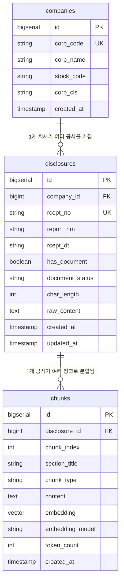

# 데이터베이스 설계 (ERD)

`companies` → `disclosures` → `chunks` 3단계로 이어지는 구조다. 회사 하나가 여러 공시를
갖고, 공시 하나가 여러 청크로 쪼개져 검색 인덱스로 들어간다.

## 설계 배경

- **청크를 ElasticSearch와 pgvector 양쪽에 저장하는 이유 (RRF 융합)**
  키워드 매칭(재무 수치, 회사명, 법정 용어 등 정확히 일치해야 하는 질의)은 ElasticSearch의
  역색인이 유리하고, 의미 기반 유사도 질의는 pgvector의 벡터 검색이 유리하다. 한쪽만 쓰면
  질의 유형에 따라 재현율이 크게 떨어지므로, 두 검색 결과를 RRF(Reciprocal Rank Fusion)로
  합쳐 최종 순위를 매긴다. `chunks` 테이블은 이 융합의 단일 소스(source of truth) 역할을
  하고, `content`는 ElasticSearch 색인용, `embedding`은 pgvector 색인용으로 각각 동기화된다.

- **`document_status`로 배치 재시작 가능하게 한 이유**
  공시 원문 수집 → 파싱 → 청킹은 여러 단계(fetch → parse → chunk)로 이루어지는 배치
  파이프라인이고, [dart-findings.md](./dart-findings.md)에서 확인했듯 문서마다 크기 편차가 크고(1,591자~123,413자)
  일부는 XML이 well-formed하지 않아 파싱이 중간에 실패할 수 있다. 각 공시가 파이프라인의
  어느 단계까지 처리됐는지(`PENDING`/`FETCHED`/`PARSED`/`CHUNKED`/`FAILED`)를 기록해두면,
  배치가 중단되거나 특정 문서에서 실패해도 전체를 처음부터 다시 돌리지 않고 실패/미완료 건만
  골라 재처리할 수 있다.

- **`report_nm`으로 문서 유형별 청킹 전략을 분기하는 이유**
  [dart-findings.md](./dart-findings.md)에서 정리했듯 소유상황보고서 같은 정형 서식은 문서 전체가 작아 통째로
  1개 청크면 충분하지만, 투자설명서·사업보고서류는 구조 기반 1차 분할 + 슬라이딩 윈도우가
  필요하다. 이 분기 기준이 `report_nm`이므로, `disclosures.report_nm`을 청킹 배치가 참조해
  문서 유형에 맞는 전략을 선택한다.

## ERD

## 테이블 설명

### companies

| 컬럼 | 타입 | 목적 |
|---|---|---|
| `id` | bigserial (PK) | 내부 식별자 |
| `corp_code` | string (UK) | DART 회사 고유번호. list/document API 호출 시 회사를 특정하는 키 |
| `corp_name` | string | 회사명 |
| `stock_code` | string (nullable) | 종목코드. 비상장사는 값이 없어 nullable |
| `corp_cls` | string | 법인구분 (유가/코스닥/코넥스/기타) |
| `created_at` | timestamp | 레코드 생성 시각 |

### disclosures

| 컬럼 | 타입 | 목적 |
|---|---|---|
| `id` | bigserial (PK) | 내부 식별자 |
| `company_id` | bigint (FK → companies.id) | 해당 공시를 제출한 회사 |
| `rcept_no` | string (UK) | 접수번호. document API 호출 시 원문을 특정하는 키 |
| `report_nm` | string | 보고서명. 청킹 전략을 문서 유형별로 분기하는 기준값 |
| `rcept_dt` | string | 공시 접수일자 |
| `has_document` | boolean | 원문 존재 여부. document API가 `status=014`(원문 없음)를 반환한 공시를 구분해두어, 파싱/청킹 단계에서 다시 건드리지 않도록 함 |
| `document_status` | string | 파이프라인 진행 상태 (`PENDING`/`FETCHED`/`PARSED`/`CHUNKED`/`FAILED`). 배치 재시작·재처리 판단 기준 |
| `char_length` | int | 정제(태그 제거) 후 텍스트 길이. 문서 크기 편차가 크므로 처리 비용 추정·모니터링에 사용 |
| `raw_content` | text | 정제된 원문 전체 텍스트. 재청킹 시 원문 API를 다시 호출하지 않고 재사용 |
| `created_at` | timestamp | 레코드 생성 시각 |
| `updated_at` | timestamp | `document_status` 등 상태 변경 시각 |

### chunks

| 컬럼 | 타입 | 목적 |
|---|---|---|
| `id` | bigserial (PK) | 내부 식별자 |
| `disclosure_id` | bigint (FK → disclosures.id) | 이 청크가 속한 공시 |
| `chunk_index` | int | 공시 내 청크 순번. 원문 내 순서 복원 및 인접 청크 조회에 사용 |
| `section_title` | string (nullable) | 법정 서식 섹션명 (예: "1. 발행회사에 관한 사항"). 구조 기반 1차 분할 결과를 보존해 검색 결과의 출처를 사람이 읽을 수 있게 함 |
| `chunk_type` | string | `TEXT` / `TABLE`. 표는 라벨-값 관계를 살려 별도 직렬화하므로 일반 텍스트 청크와 구분 |
| `content` | text | 청크 텍스트 본문. ElasticSearch 색인 대상 |
| `embedding` | vector(1536) | pgvector 임베딩. 의미 기반 유사도 검색에 사용 |
| `embedding_model` | string | 임베딩 생성에 사용한 모델명 (예: `text-embedding-3-small`). 모델 교체 시 재임베딩 대상 식별에 사용 |
| `token_count` | int | 청크 토큰 수. 슬라이딩 윈도우 크기 검증 및 LLM 컨텍스트 예산 계산에 사용 |
| `created_at` | timestamp | 레코드 생성 시각 |
