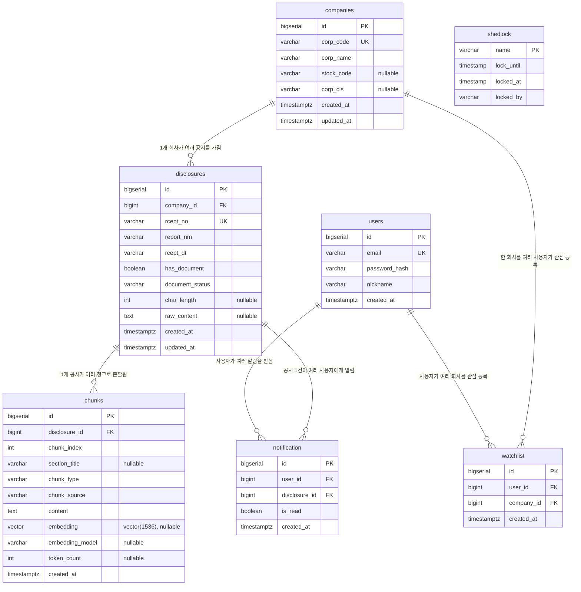

# 데이터베이스 설계 (ERD)

마지막 갱신: 2026-10-12 — Flyway V1~V7과 JPA 엔티티를 직접 대조해 다시 썼다. 그 전 버전은 V1 설계
시점의 내용이라 이후 추가된 컬럼(`chunk_source`), 상태값(`NO_DOCUMENT`/`INDEXED`), 테이블
(`users`/`watchlist`/`notification`/`shedlock`)이 빠져 있었고, 청킹 분기 기준도 실제 구현과 달랐다.

**스키마의 기준은 이 문서가 아니라 `backend/src/main/resources/db/migration/`의 Flyway
스크립트다.** JPA는 `ddl-auto: validate`로 검증만 한다. 이 문서와 마이그레이션이 다르면 문서가
틀린 것이다.

## 전체 구조

테이블은 세 묶음이다.

- **공시 파이프라인**: `companies` → `disclosures` → `chunks`. 회사 하나가 여러 공시를 갖고, 공시
  하나가 여러 청크로 쪼개져 검색 인덱스로 들어간다.
- **사용자 기능**: `users`, `watchlist`(사용자가 관심 등록한 회사), `notification`(관심 회사의
  신규 공시 알림).
- **운영**: `shedlock`(스케줄러 분산 락).



## 설계 배경

- **청크를 ElasticSearch와 pgvector 양쪽에 저장하는 이유 (RRF 융합)**
  키워드 매칭(회사명, 재무 수치, 법정 용어처럼 정확히 일치해야 하는 질의)은 ElasticSearch의
  역색인이 유리하고, 의미 기반 유사도 질의는 pgvector의 벡터 검색이 유리하다. 두 검색 결과를
  RRF(Reciprocal Rank Fusion)로 합치려면 두 검색의 단위가 같아야 하므로 둘 다 청크 단위로 색인한다.
  `chunks` 테이블이 단일 소스(source of truth)이고, `content`는 ES 색인으로, `embedding`은 pgvector
  인덱스로 들어간다. ES 문서 id는 `chunks.id`를 그대로 쓴다(`IndexingService`) — 두 검색 결과를 같은
  키로 합치기 위함이다.
  실제로 두 검색이 각각 얼마나 기여하는지는 문서 유형에 따라 크게 달랐다 —
  [search-quality-eval.md](./search-quality-eval.md) 참고.

- **`document_status`로 배치를 재시작 가능하게 한 이유**
  공시 원문 수집 → 정제 → 청킹 → 색인은 여러 단계의 배치 파이프라인이고,
  [dart-findings.md](./dart-findings.md)에서 확인했듯 문서 크기 편차가 크고 일부는 XML이
  well-formed하지 않아 중간에 실패할 수 있다. 공시마다 어느 단계까지 처리됐는지를 기록해두면
  배치가 중단돼도 미완료 건만 골라 이어서 처리할 수 있다. 각 스케줄러는 "자기 앞 단계 상태인
  공시"만 집어 간다(아래 상태 전이).

- **청킹 전략의 분기 기준은 `report_nm`이 아니라 `char_length`와 섹션 마커다**
  처음 설계는 `report_nm`(문서 유형) 문자열로 분기하는 것이었지만 구현하면서 바꿨다
  (dart-findings.md 2-5, 3절 "구현 현황"). `report_nm`은 `[기재정정]` 접두어 같은 표기 변형이 많아
  문자열 매칭이 쉽게 깨지기 때문이다. 실제 분기(`ChunkingService`)는 다음과 같고, 어느 경로로
  만들어진 청크인지는 `chunks.chunk_source`에 남는다.

  | 조건 | 전략 | `chunk_source` |
  |---|---|---|
  | `raw_content` 길이 < 2,000자 (`chunking.whole-document-char-threshold`) | 문서 전체를 1개 청크로 | `WHOLE_DOCUMENT` |
  | 그 이상이고 `[[SECTION]]` 마커가 있음(XML을 DOM으로 파싱하는 데 성공) | 섹션 단위로 분할, 큰 섹션은 그 안에서 슬라이딩 윈도우(800자/150자 오버랩) | `SECTION` |
  | 그 이상이고 마커가 없음(정규식 폴백으로 정제됨 - 구조를 모름) | 길이 기준 슬라이딩 윈도우만 | `SLIDING_WINDOW` |

  `report_nm`은 지금 청킹에 쓰이지 않고, 검색 결과와 프롬프트에 표시하는 메타데이터로만 쓰인다.

## `document_status` 상태 전이

`DocumentStatus` enum과 일치한다(내부에서 통제하는 값이라 Enum, DB에는 문자열로 저장).

```
PENDING ──(원문 ZIP 수신)──▶ FETCHED ──(정제 성공)──▶ PARSED ──(청킹)──▶ CHUNKED ──(ES 색인)──▶ INDEXED
   │                            │
   ├──(DART status=014)──▶ NO_DOCUMENT   (원문이 없는 공시 - 종결)
   └──(그 외 예외)────────▶ FAILED        (종결 - 자동 재시도 없음)
```

| 상태 | 의미 | 다음 단계를 처리하는 곳 |
|---|---|---|
| `PENDING` | 목록 API로 공시의 존재만 저장됨(기본값) | `DocumentCollectorService` |
| `FETCHED` | 원문 ZIP을 받아 XML을 꺼냄. 정제 직전의 짧은 중간 상태 | (같은 메서드 안에서 바로 정제) |
| `PARSED` | 정제된 텍스트가 `raw_content`에 저장됨 | `ChunkingService` |
| `CHUNKED` | 청크가 `chunks`에 저장됨 | `IndexingService` |
| `INDEXED` | 청크가 Elasticsearch에 색인됨 | (끝) |
| `NO_DOCUMENT` | DART가 `status=014`(원문 없음)를 반환. `has_document=false` | (끝) |
| `FAILED` | 수집/정제 중 예외 | (끝 - 아래 주의) |

- **임베딩은 이 상태 기계 밖에 있다.** `EmbeddingService`는 `document_status`를 보지 않고
  `chunks.embedding IS NULL`인 청크를 직접 찾아 채운다. 그래서 `INDEXED`인데 임베딩이 아직 없는
  청크가 있을 수 있고(키워드 검색에는 걸리고 벡터 검색에는 안 걸림), 반대도 가능하다.
- **`FAILED`는 자동으로 다시 시도되지 않는다.** 일시적인 네트워크 오류나 DART 호출 한도 초과로
  실패해도 영구 실패로 남는다 — 알려진 한계(progress.md 미해결 백로그).
- 재색인이 필요하면 `INDEXED`를 `CHUNKED`로 되돌리면 `IndexingService`가 다시 색인한다(EC2 데이터
  이전 때 실제로 쓴 방법 - deploy.md 19절).

## 테이블 설명

### companies

| 컬럼 | 타입 | 제약 | 목적 |
|---|---|---|---|
| `id` | bigserial | PK | 내부 식별자 |
| `corp_code` | varchar(255) | NOT NULL, UNIQUE | DART 회사 고유번호(8자리). 회사를 식별하는 유일하게 신뢰할 수 있는 키 |
| `corp_name` | varchar(255) | NOT NULL | 회사명. **유일하지 않다**(동명 회사가 전체의 11.3% - dart-findings.md 2-11) |
| `stock_code` | varchar(255) | nullable | 종목코드. 비상장사는 없다 |
| `corp_cls` | varchar(255) | nullable (V4) | 법인구분(Y 유가/K 코스닥/N 코넥스/E 기타). DART가 정의하는 외부 값이라 Enum이 아닌 문자열. corpCode.xml에는 이 값이 없어, 그 회사의 공시를 목록 API로 처음 만날 때 채워진다 |
| `created_at` | timestamptz | NOT NULL | 생성 시각 |
| `updated_at` | timestamptz | NOT NULL (V4) | corpCode.xml 동기화가 회사명/종목코드를 갱신한 시각 |

- 약 11.8만 건. 대부분은 corpCode.xml 전체 적재로 들어온 회사이고, 공시가 실제로 있는 회사는 그
  일부다.
- 회사명 자동완성(`LIKE '%q%'`)용으로 V4에서 추가했던 `pg_trgm` GIN 인덱스는 실측 결과 쓰이지 않아
  V5에서 제거했다(dart-findings.md 2-12). `pg_trgm` 확장 자체는 남아 있다.

### disclosures

| 컬럼 | 타입 | 제약 | 목적 |
|---|---|---|---|
| `id` | bigserial | PK | 내부 식별자 |
| `company_id` | bigint | NOT NULL, FK → companies(id) ON DELETE CASCADE | 공시를 제출한 회사 |
| `rcept_no` | varchar(255) | NOT NULL, UNIQUE | 접수번호. 원문 API의 키이자 DART 뷰어 URL의 키. 수집 시 중복 판정 기준 |
| `report_nm` | varchar(255) | NOT NULL | 보고서명. 검색 결과/프롬프트에 표시하는 메타데이터 |
| `rcept_dt` | varchar(255) | NOT NULL | 접수일자(`YYYYMMDD` 문자열, DART 응답 그대로) |
| `has_document` | boolean | NOT NULL, 기본 false | 원문 존재 여부. 원문을 실제로 받아 정제에 성공하면 true |
| `document_status` | varchar(255) | NOT NULL, 기본 `PENDING` | 파이프라인 진행 상태(위 상태 전이) |
| `char_length` | int | nullable | 정제 후 텍스트 길이. 청킹 전략 분기 기준 |
| `raw_content` | text | nullable | 정제된 원문 전체. 섹션 경계는 `[[SECTION]]` 마커로 들어 있다. 재청킹 시 원문 API를 다시 부르지 않기 위해 보관 |
| `created_at` | timestamptz | NOT NULL | 수집 시각. **알림 감지의 기준**(관심 등록 이후에 수집된 공시만 알림) |
| `updated_at` | timestamptz | NOT NULL | 상태가 마지막으로 바뀐 시각 |

인덱스: `idx_disclosures_document_status`(배치가 상태로 대상을 고름), `idx_disclosures_company_id`
(FK 컬럼 - Postgres는 FK를 자동으로 인덱싱하지 않는다).

### chunks

| 컬럼 | 타입 | 제약 | 목적 |
|---|---|---|---|
| `id` | bigserial | PK | 내부 식별자. Elasticsearch 문서 id로도 그대로 쓰인다 |
| `disclosure_id` | bigint | NOT NULL, FK → disclosures(id) ON DELETE CASCADE | 이 청크가 속한 공시 |
| `chunk_index` | int | NOT NULL, (disclosure_id, chunk_index) UNIQUE | 공시 내 청크 순번 |
| `section_title` | varchar(255) | nullable | 섹션명(예: "III. 투자위험요소"). `SECTION` 청크에만 있고 출처 표시에 쓰인다 |
| `chunk_type` | varchar(255) | NOT NULL | `TEXT` / `TABLE`. **현재는 모든 청크가 `TEXT`다** — 표는 정제 단계에서 `셀1 \| 셀2` 형태로 본문에 합쳐지고 별도 `TABLE` 청크로 분리하지 않는다(표 전용 처리는 보류, progress.md) |
| `chunk_source` | varchar(255) | NOT NULL (V2) | `WHOLE_DOCUMENT` / `SECTION` / `SLIDING_WINDOW`. 어떤 청킹 경로로 만들어졌는지(위 표). 검색 품질을 경로별로 비교하는 데 쓴다 |
| `content` | text | NOT NULL | 청크 본문. Elasticsearch(Nori)에 색인되고 LLM 컨텍스트로 들어간다 |
| `embedding` | vector(1536) | nullable | `text-embedding-3-small` 임베딩. 임베딩 배치가 채우기 전에는 NULL |
| `embedding_model` | varchar(255) | nullable | 임베딩을 만든 모델명. 모델을 바꿀 때 재임베딩 대상을 가려내기 위함 |
| `token_count` | int | nullable | 임베딩 전 로컬에서 계산한 토큰 수(8,191 초과 청크를 API 호출 전에 걸러냄) |
| `created_at` | timestamptz | NOT NULL | 생성 시각 |

인덱스: `idx_chunks_disclosure_id`, `idx_chunks_embedding_hnsw`(HNSW, `vector_cosine_ops`).
HNSW를 고른 이유는 빈 테이블에서 시작해 배치로 채워지는 구조라 IVFFlat(데이터가 쌓인 뒤 클러스터
수를 정해야 품질이 나옴)보다 맞기 때문이다(V1 주석).

약 17.3만 건. 한 공시가 1개(정형 서식)에서 900개 이상(투자설명서)까지 쪼개진다 — 이 편차가 검색
품질에 미치는 영향은 [answer-quality-eval.md](./answer-quality-eval.md) 5-3절.

### users (V3)

| 컬럼 | 타입 | 제약 | 목적 |
|---|---|---|---|
| `id` | bigserial | PK | 내부 식별자. JWT의 subject |
| `email` | varchar(255) | NOT NULL, UNIQUE | 로그인 ID. 소문자·앞뒤 공백 제거로 정규화해 저장 |
| `password_hash` | varchar(255) | NOT NULL | BCrypt 해시(평문은 저장하지 않는다) |
| `nickname` | varchar(50) | NOT NULL | 표시용 이름(API 검증은 2~20자) |
| `created_at` | timestamptz | NOT NULL | 가입 시각 |

토큰은 DB에 저장하지 않는다(Stateless JWT). 그래서 refresh 토큰을 서버에서 무효화할 수 없다 —
의도적 결정이자 알려진 한계다.

### watchlist (V3)

| 컬럼 | 타입 | 제약 | 목적 |
|---|---|---|---|
| `id` | bigserial | PK | 내부 식별자 |
| `user_id` | bigint | NOT NULL, FK → users(id) ON DELETE CASCADE | 등록한 사용자 |
| `company_id` | bigint | NOT NULL, FK → companies(id) ON DELETE CASCADE | 관심 회사 |
| `created_at` | timestamptz | NOT NULL | 등록 시각. **알림 감지의 기준**(이 시각 이후 수집된 공시만 알림) |

제약: `(user_id, company_id)` UNIQUE — 같은 회사를 두 번 등록할 수 없다.
인덱스: `idx_watchlist_user_id`("내 관심 목록"), `idx_watchlist_company_id`(알림 감지의 조인).

### notification (V6)

| 컬럼 | 타입 | 제약 | 목적 |
|---|---|---|---|
| `id` | bigserial | PK | 내부 식별자 |
| `user_id` | bigint | NOT NULL, FK → users(id) ON DELETE CASCADE | 알림을 받는 사용자 |
| `disclosure_id` | bigint | NOT NULL, FK → disclosures(id) ON DELETE CASCADE | 알림 대상 공시 |
| `is_read` | boolean | NOT NULL, 기본 false | 읽음 여부 |
| `created_at` | timestamptz | NOT NULL | 알림 생성 시각 |

제약: `(user_id, disclosure_id)` UNIQUE — 같은 사용자에게 같은 공시의 알림은 1건. 감지 배치가
`INSERT … SELECT … ON CONFLICT DO NOTHING` 한 문장이라, 겹치는 범위를 다시 실행해도 중복이 생기지
않는다(`NotificationRepository.detectAndInsertNotifications`).
인덱스: `idx_notification_user_unread (user_id, is_read, created_at DESC)` — 실제 조회 쿼리가 이
인덱스를 타는지는 아직 `EXPLAIN`으로 확인하지 않았다(progress.md).

### shedlock (V7)

ShedLock 라이브러리의 공식 스키마 그대로다. blue-green 배포 중 인스턴스가 잠깐 2개 뜰 때 같은
`@Scheduled` 배치가 양쪽에서 동시에 실행되는 것을 막는다(deploy.md 13절). 애플리케이션 엔티티는
없다 — 라이브러리가 JDBC로 직접 읽고 쓴다.

| 컬럼 | 타입 | 목적 |
|---|---|---|
| `name` | varchar(64), PK | 락 이름(스케줄러별 고정 문자열) |
| `lock_until` | timestamp | 이 시각까지 락이 유효 |
| `locked_at` | timestamp | 락을 잡은 시각 |
| `locked_by` | varchar(255) | 락을 잡은 인스턴스 |

## 엔티티 연관관계 (JPA)

- **회사 ↔ 공시: 단방향**(`Disclosure.company`만 있고 `Company`에는 컬렉션이 없다). 회사당 공시가
  많아질 수 있어 컬렉션으로 들고 있지 않고 조회는 Repository 쿼리로 한다. `watchlist`,
  `notification`도 같은 이유로 단방향이다.
- **공시 ↔ 청크: 양방향 + cascade + orphanRemoval**(`Disclosure.chunks`). 재청킹이 "기존 청크를
  지우고 다시 만든다"는 흐름이라 공시가 자기 청크의 생애주기를 관리한다.
- 연관은 전부 `LAZY`다. 검색 결과를 조립할 때 청크 → 공시 → 회사를 따라가므로
  `HybridSearchService.search()`가 읽기 전용 트랜잭션으로 세션을 유지한다.

## 마이그레이션 이력

| 버전 | 내용 |
|---|---|
| V1 | `companies`, `disclosures`, `chunks`, HNSW 인덱스, `vector` 확장 |
| V2 | `chunks.chunk_source` 추가 |
| V3 | `users`, `watchlist` |
| V4 | `companies.corp_cls` nullable로 완화, `companies.updated_at` 추가, `pg_trgm` 확장 + 회사명 GIN 인덱스 |
| V5 | 쓰이지 않는 회사명 GIN 인덱스 제거(실측 근거: dart-findings.md 2-12) |
| V6 | `notification` |
| V7 | `shedlock` |
